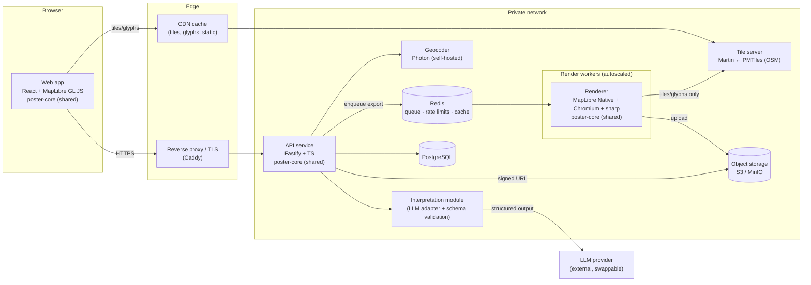
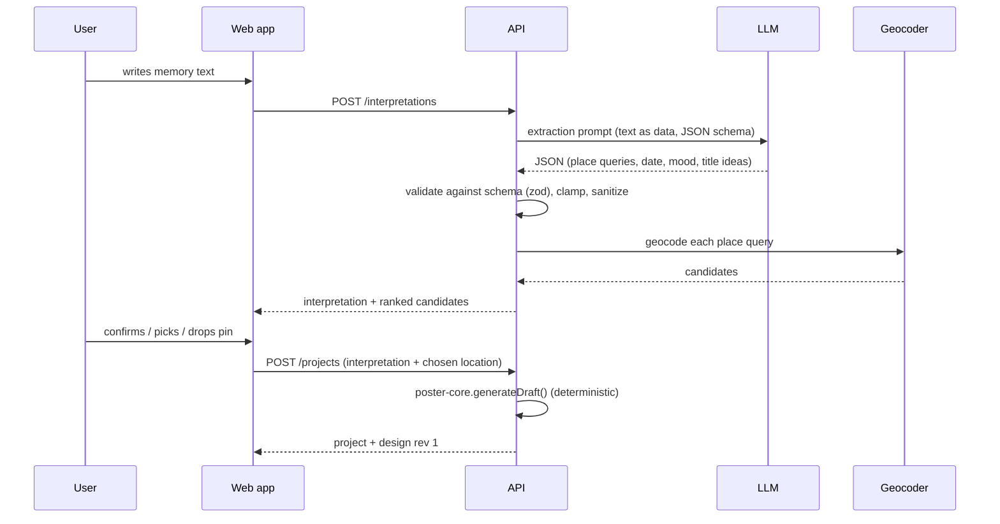
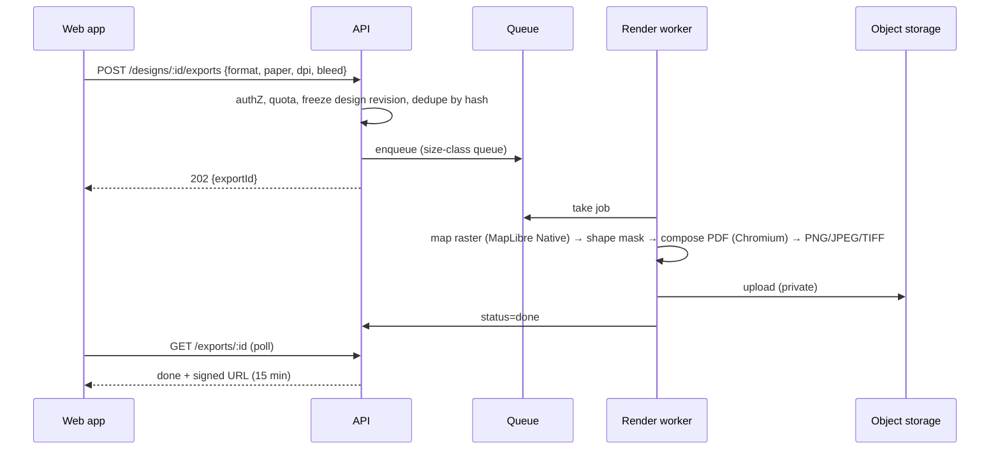

# Mapmory: Implementation Plan

Status: **implemented (MVP + most of v1)** · 2026-10-22 · built from [planning-prompt.md](planning-prompt.md).
See the [README](../README.md) to run it, [api.md](api.md) for the contract, [adr/](adr/README.md) for the decisions and
Phase 0 results, and [§15](#15-implementation-notes) for where the implementation differs from this plan.

Mapmory turns a written memory ("The night we got engaged on the Pont des Arts, 14 June 2019") into a map poster that the user can customize and send to a print shop.

---

## 1. Assumptions and open questions

### Assumptions (used as defaults in this plan)

| # | Assumption | Why it matters |
|---|---|---|
| A1 | It is a **responsive web app** (desktop first, usable on mobile). There is no native app. | It decides the frontend stack. |
| A2 | It is hosted in the **EU**, and GDPR applies. | It shapes hosting, the choice of LLM provider and data retention. |
| A3 | The team is **1–2 developers**, and early volume is up to a few thousand exports per month. | It sizes the infrastructure and the roadmap. |
| A4 | Anyone can **design without an account**. **Exporting needs a verified email** (magic link). | Abuse control on expensive render jobs, and it prepares for a later print-shop integration. |
| A5 | The LLM is a **hosted API behind a swappable interface**, with zero data retention. A self-hosted open-weight model is an alternative. | Privacy, and it avoids lock-in. |
| A6 | The UI is in **English first** and built ready for translation (DE/PT next). Map labels follow the user's language where OSM has the data. | i18n is built in from the start. |
| A7 | A poster contains **one design that scales proportionally** to every paper size. An A0 poster looks like an enlarged A4, not a map with more detail. | This is the key rendering decision; see §7.1. |
| A8 | Only **SIL OFL / Apache licensed fonts** are used, so they can be embedded in PDFs. | Licensing. |

### Open questions (the answers can change the plan)

1. **Business model**: free, freemium (watermark-free export is paid) or sold together with printing? This decides whether payments come in the MVP.
2. **Target print providers**: which shops, and what file specs do they need (PDF/X, CMYK, bleed size, maximum file size)?
3. **Accounts**: is an email required to export, or are anonymous exports allowed?
4. **LLM**: a hosted API (which provider?) or self-hosted for maximum privacy?
5. **Languages and markets** at launch?
6. **Branding and visual identity**: is there a design or brand already?
7. **Largest format**: is A0 needed at launch, or is A2 enough?

---

## 2. High-level architecture



**Main design principle: one source of truth for rendering.**
The `design` JSON document (§4) is the only input the preview and the exporter use. A shared TypeScript package, `poster-core`, turns it into the MapLibre style, the poster layout and the marker positions. The browser preview, the API (which builds the first draft) and the render worker all import this package. This is the main defense against "the export doesn't match the preview", and it is also why the backend uses TypeScript.

### Request flows

**Create a draft**



**Export**



---

## 3. Technology choices

### Recommended stack

| Area | Choice | Alternatives considered | Reasoning |
|---|---|---|---|
| Monorepo | **pnpm workspaces + Turborepo** | Nx | Simple, and makes it easy to share `poster-core` and `design-schema`. |
| Language | **TypeScript** everywhere | Python backend (FastAPI) | Preview and renderer must share the same layout and style code. |
| Frontend | **React 19 + Vite**, React Router | SvelteKit, Next.js | Largest ecosystem for accessible components. An SPA is enough because the landing page can be static. |
| UI components | **Radix UI primitives + Tailwind** (shadcn/ui pattern) | MUI, Mantine | Accessible by default and fully stylable. |
| State | **Zustand + zundo** (undo/redo) + **TanStack Query** (server state) | Redux Toolkit | Little boilerplate, and zundo gives temporal history. |
| Preview map | **MapLibre GL JS** | Leaflet, OpenLayers | Vector tiles, styles can be changed at runtime, rotation, and the same style spec as the native renderer. |
| Validation | **zod** (shared schemas) | JSON Schema + ajv | One schema for the frontend, the API, LLM output and the renderer. zod can also generate JSON Schema for the LLM. |
| API | **Fastify** + `fastify-type-provider-zod`, `@fastify/helmet`, `@fastify/rate-limit` | NestJS, Express | Fast, with typed schema validation on every route. |
| Database | **PostgreSQL 16** + **Drizzle ORM** | Prisma | Typed SQL, simple migrations. |
| Queue / cache | **Redis + BullMQ** | RabbitMQ, pg-boss | Job progress, retries and priorities. Redis is also used for rate limits and the geocode cache. |
| Map export | **@maplibre/maplibre-gl-native** (Node bindings), headless | Headless Chromium running GL JS | No WebGL canvas size limits, and it is the same style spec as the preview. To be confirmed in spike S1. |
| Composition / PDF | **Headless Chromium (Playwright)** printing a local "print page" built from the same React poster components | PDFKit + svg-to-pdfkit | Vector text with embedded fonts, and the same layout code as the preview. |
| Raster processing | **sharp (libvips)**, **poppler `pdftocairo`** | ImageMagick | Fast, memory-efficient, sets DPI metadata and ICC profiles. |
| Vector tiles | **Protomaps basemap PMTiles** (planet build from OSM) served by **Martin** | OpenMapTiles via Planetiler, raster OSM tiles | A single file on object storage, open styles, daily builds. Martin serves standard XYZ tiles to both renderers. You can switch to your own Planetiler build later for more control. |
| Glyphs (map labels) | Self-hosted PBF glyphs generated from the same OFL fonts (`font-maker`) | Third-party font CDNs | No external calls, and label fonts match the poster fonts. |
| Geocoding | **Photon** (self-hosted) behind a `Geocoder` interface. In dev or early MVP: a Nominatim instance or a hosted OSM-based provider within its usage policy. | Public Nominatim in production | Public Nominatim forbids heavy or autocomplete use. Photon supports type-ahead and multiple languages. |
| LLM | `InterpretationProvider` interface. Default: a small, fast hosted model with structured output (for example a Claude Haiku-class model). Option: open-weight model on vLLM or Ollama. | Fine-tuned NER | Handles messy, multilingual memories. The schema-validated output keeps it safe. |
| Auth | **Better Auth** (TS, self-hosted): email magic link + optional OAuth (Google/Apple), cookie sessions | Ory Kratos, Keycloak | Light, and it runs inside the API. Kratos would be the upgrade path. |
| Bot protection | **ALTCHA** (open-source proof-of-work) on interpretation and export for anonymous or new users | hCaptcha | Open source, no tracking cookies. |
| Observability | OpenTelemetry → Prometheus/Grafana/Loki; **GlitchTip** (open-source, Sentry-compatible) for errors | Hosted Sentry | Self-hosted, PII stays under control. |
| Analytics | **Umami** or **Plausible** (self-hosted, cookieless) | GA | No consent banner is needed for analytics. |
| Infra | Docker images, Docker Compose (dev); production on EU VMs (e.g. Hetzner/OVH) with Compose or k3s; S3-compatible storage | Managed Kubernetes | Small team, low cost. Can move to Kubernetes later. |

### Repository layout

```
mapmory/
  apps/
    web/            React SPA (wizard, editor, export)
    api/            Fastify API (auth, projects, designs, exports, interpretation, geocode proxy)
    renderer/       BullMQ worker (MapLibre Native, Chromium, sharp, poppler)
    print-page/     Minimal static bundle Chromium loads to compose the PDF
  packages/
    design-schema/  zod schemas, types, versioned migrations
    poster-core/    buildStyle(), layout(), projectMarker(), generateDraft(), paper sizes, units
    poster-react/   Poster overlay components (text, frame, markers, shape masks), used by web + print-page
    themes/         Theme templates + palettes (data only)
    fonts/          OFL font files + generated glyph PBFs + font catalog
    config/         eslint, tsconfig, shared constants
  infra/            docker-compose, Caddyfile, Martin config, tile/geocoder setup scripts
  docs/
```

---

## 4. Data model

### 4.1 The `design` document (versioned, schema `v1`)

**Units.** Every position and size uses **design units (du)**. The page width (trim) is always **1000 du**, whatever the paper. The page height in du follows the aspect ratio (A-series: 1414 du; 50×70: 1400 du). So:

- Changing between sizes with the same aspect ratio (A4 → A0) scales everything proportionally.
- Changing the aspect ratio (A3 → 50×70) re-flows elements around their anchors.
- `mm = du × trimWidthMm / 1000`. The UI shows font sizes in pt for the chosen paper, for familiarity.

```jsonc
{
  "schemaVersion": 1,
  "page": {
    "paper": "A3",                 // enum from the catalog, or "custom"
    "trimMm": { "w": 297, "h": 420 },
    "orientation": "portrait",
    "marginDu": 60,
    "background": "#F4EFE6",
    "frame": { "style": "thin-line", "color": "#2B2B2B", "widthDu": 2, "insetDu": 30 }
  },
  "map": {
    "areaDu": { "x": 60, "y": 60, "w": 880, "h": 1000 },   // map viewport on the page
    "center": [2.33753, 48.85826],
    "zoom": 15.2,
    "bearing": 0,
    "shape": "rect",              // rect | rounded | circle | heart | arch …
    "themeId": "classic-ink",
    "palette": {
      "background": "#F4EFE6", "water": "#BFD3D9", "parks": "#DCE3CF",
      "roads": "#2B2B2B", "roadsMinor": "#8A8A8A", "buildings": "#E6DFD3", "labels": "#2B2B2B"
    },
    "layers": { "roads": true, "buildings": true, "water": true, "parks": true, "railways": false, "labels": false },
    "labelLanguage": "en"
  },
  "markers": [
    { "id": "m1", "lngLat": [2.33753, 48.85826], "icon": "heart", "color": "#C0392B", "sizeDu": 28 }
  ],
  "texts": [
    { "id": "title", "role": "title", "content": "Where it all began",
      "fontId": "playfair-display", "weight": 700, "sizeDu": 64, "letterSpacing": 0.02,
      "uppercase": false, "color": "#2B2B2B", "align": "center",
      "slot": "bottom-1", "offsetDu": [0, 0], "visible": true },
    { "id": "subtitle", "role": "subtitle", "content": "Pont des Arts · Paris", "...": "..." },
    { "id": "date", "role": "date", "content": "14 June 2019", "...": "..." },
    { "id": "coords", "role": "coordinates", "content": "48.8583° N, 2.3375° E", "...": "..." }
  ],
  "attribution": { "corner": "bottom-right" }   // position can change, it cannot be removed
}
```

**Validation rules** (in `design-schema`, applied everywhere):

- Colors must match `^#[0-9A-Fa-f]{6}$`.
- `themeId`, `fontId`, `icon`, `shape`, `paper` and `frame.style` must be **enums from the catalog**. There are **no URLs anywhere in the document**, which rules out SSRF through the design.
- Numbers have bounds: zoom 1–18, lat ±85.05, lng ±180, sizes and positions within the page.
- Text content is at most 120 characters (title) or 200 (others), in plain Unicode text, with control characters stripped.
- At most 20 markers and 8 text blocks. The serialized document is at most 64 KB.
- `schemaVersion` plus a chain of migration functions (`migrate_v1_to_v2`) so old saved designs keep working.

### 4.2 Database tables

| Table | Key columns | Notes |
|---|---|---|
| `users` | id (uuid), email (unique), email_verified_at, locale, created_at, deleted_at | Managed by Better Auth (plus `sessions`, `verification_tokens`). |
| `anon_sessions` | id, created_at, expires_at, quota counters | Ties anonymous work to a cookie. It is merged into the user when they sign up. |
| `projects` | id, owner_user_id \| owner_anon_id, title, memory_text (nullable, encrypted), interpretation (jsonb), created_at, updated_at, expires_at | `memory_text` is kept only if the user opts in (see §8.4). |
| `design_revisions` | id, project_id, revision (int), schema_version, document (jsonb), content_hash, created_at | Every save is immutable; `projects.current_revision` points to the latest. The list is trimmed to the last N revisions. |
| `export_jobs` | id, project_id, revision_id, options (jsonb: format, paper, dpi, bleed, cropMarks), options_hash, status (queued/rendering/composing/uploading/done/failed/expired), progress, error_code, object_key, bytes, created_at, finished_at, expires_at | Deduplicated on `(content_hash, options_hash)`. |
| `audit_events` | id, actor, action, target, ip_hash, created_at | Security-relevant events only (login, export, delete). No content. |

---

## 5. API design (v1)

Every route is under `/api/v1`, uses JSON, and validates its request with zod. Errors use RFC 9457 problem+json. Session is a cookie. State-changing calls require a same-origin `Origin` check plus a CSRF token header.

| Method | Path | Purpose | Notes |
|---|---|---|---|
| POST | `/interpretations` | `{ text, locale }` → `{ places: [{query, role, candidates[]}], date, titleIdeas[], subtitleIdea, mood, themeSuggestion }` | text ≤ 1000 chars; strict rate limit; ALTCHA for anonymous users. |
| GET | `/geocode?q=&lang=&limit=` | Location search / autocomplete → candidates `{id, name, label, lngLat, bbox, type}` | Goes through the self-hosted Photon. Cached in Redis. Rate limited. |
| GET | `/geocode/reverse?lat=&lng=` | Label for a dropped pin | Same as above. |
| POST | `/projects` | `{ interpretation?, location, overrides? }` → `{ project, design (rev 1) }` | Runs `poster-core.generateDraft()`. |
| GET | `/projects` / `/projects/:id` | List or read own projects | Owner check on every query. |
| DELETE | `/projects/:id` | Delete a project, its revisions and its exports | Hard delete; objects are purged asynchronously. |
| GET | `/projects/:id/design` | Current design + `ETag: revision` | |
| PUT | `/projects/:id/design` | Save the full document; `If-Match: <revision>` | 409 on conflict, then the client re-bases. Autosave is debounced. |
| POST | `/projects/:id/design/reset` | Go back to the draft (rev 1) as a new revision | |
| POST | `/projects/:id/exports` | `{ format: pdf\|png\|jpeg\|tiff, dpi: 150\|200\|300, bleedMm: 0\|3\|5, cropMarks }` → `202 { exportId }` | Needs a verified email (A4). Per-user quota. Only one active job per user. |
| GET | `/exports/:id` | `{ status, progress, error?, downloadUrl? }` | `downloadUrl` is a signed URL valid for 15 minutes, with `Content-Disposition: attachment`. |
| GET | `/catalog` | Themes, palettes, fonts, icons, shapes, paper sizes, frame styles | Public and cacheable. |
| GET | `/me/data-export` · DELETE `/me` | GDPR access and erasure | |
| — | `/auth/*` | Magic link, OAuth callbacks, logout | Provided by Better Auth. |

---

## 6. Frontend plan

### 6.1 Routes and steps

1. `/` landing page (static, examples, privacy promise)
2. `/create`, **Step 1: "Tell us your memory"**. A large text area with examples and a character counter. There is a "skip, I'll search the place myself" link, which is the non-LLM path.
3. `/create/place`, **Step 2: "Is this the place?"**. A map with ranked candidates, a search box (autocomplete) and "drop a pin". It also shows the extracted date and title, which can be edited inline. This step is always shown, because the user must confirm the location.
4. `/design/:id`, **Step 3: Editor** (most of the time is spent here)
5. `/design/:id/export`, **Step 4: Export** (format, DPI, bleed, a checklist, progress, download)
6. `/account`, `/privacy`, `/imprint`

### 6.2 Editor layout

```
┌──────────────────────────────────────────────────────────────┐
│ ◀ Back   "Where it all began"    ↶ ↷   Saved ✓   [Export ▸] │
├───────────┬──────────────────────────────────────────────────┤
│ Style     │                                                  │
│ Area      │          ┌──────────────────────┐                │
│ Markers   │          │     live poster      │   zoom-to-fit  │
│ Text      │          │   preview (true      │   bleed/safe   │
│ Layout    │          │   aspect ratio)      │   overlay ☐    │
│           │          └──────────────────────┘                │
│ [panel]   │                                                  │
└───────────┴──────────────────────────────────────────────────┘
Mobile: the preview fills the screen; panels open as a bottom sheet with tabs.
```

| Panel | Controls |
|---|---|
| **Style** | Theme gallery (thumbnails), palette swatches with hex input and color picker (`react-colorful`), layer toggles, label language |
| **Area** | Direct pan/zoom on the preview, a "lock map" toggle, a rotation slider plus "north up", "recenter on marker", a shape picker |
| **Markers** | Add or remove, icon picker, color, size, drag on the preview, "move to search result" |
| **Text** | One card per text block: content, font, weight, size (shown in pt), color, alignment, letter-spacing, uppercase, visibility, slot picker (top / over map / bottom bands) plus a fine offset |
| **Layout** | Paper size, orientation, margins, frame style, background, a print safety overlay (trim, bleed, safe zone) |

### 6.3 State management

- `useDesignStore` (Zustand) holds `design` (the schema document) and `ui` (selected panel, selection, overlay toggles) in separate slices.
- **Undo/redo**: `zundo` temporal middleware **on the `design` slice only**. While a slider or a drag is in progress, history is paused and one entry is committed when the user releases it. History is capped at 100 entries. Shortcuts: ⌘/Ctrl+Z and ⇧⌘/Ctrl+Z.
- **Autosave**: a debounced `PUT` (1.5 s) with `If-Match`. A status indicator shows saved / saving / offline. A local copy in IndexedDB lets an anonymous or offline user recover a draft.
- **Server state** (projects, catalog, export status) goes through TanStack Query.
- Every store mutation goes through typed actions that check the result against the zod schema, so invalid states can't be stored.

### 6.4 Preview rendering

- `PosterPreview` renders the page at **1000 du = 1000 logical CSS px** and scales it to fit the screen with a CSS `transform: scale()`. This keeps the preview geometrically identical to the export (§7.1). Spike S1 checks that MapLibre pointer interaction is correct under the scale. If it isn't, we add a custom pan/zoom handler that divides pointer deltas by the scale.
- The MapLibre map uses `poster-core.buildStyle(design)`. For speed, palette edits go through `setPaintProperty`, layer toggles through `setLayoutProperty('visibility')`, and theme changes through `setStyle(style, { diff: true })`.
- The overlay (texts, frame, markers, shape mask, attribution) uses components from `poster-react`, rendered as HTML/SVG on top of the map. Marker positions come from `poster-core.projectMarker()`, the same math as the export, not from MapLibre markers.
- **Accessibility (WCAG 2.2 AA)**: every control works with the keyboard. The map pans with arrow keys and zooms with +/−. Every color picker has a hex text input. Contrast is checked for text against the background (with a warning chip). Live regions announce save and export status. Focus is managed between wizard steps. `prefers-reduced-motion` is respected. axe-core runs in CI.
- **Empty, loading and error states**: skeleton poster while the draft is generated; "We couldn't find that place" with search and pin fallback; LLM outage → the manual path, explained in plain language.

---

## 7. Print and export pipeline

### 7.1 How the export matches the preview

| Input | Preview | Export |
|---|---|---|
| Page width | 1000 logical px (CSS-scaled) | 1000 logical px |
| Map center / zoom / bearing | from design | same |
| Style | `buildStyle(design)` | same function |
| `pixelRatio` | `devicePixelRatio` | `targetPxWidth / 1000` (e.g. A0 @ 300 DPI ≈ 10) |

Only `pixelRatio` changes, so MapLibre loads **the same tiles** and computes **the same label placement**, and draws them at a higher resolution. Vector geometry and SDF text stay sharp at any ratio. Rules that follow from this:

- Styles must not use raster sprite icons or raster fill patterns, because they would blur at ×10. Use SDF icons or vector overlay markers.
- Paint values that depend on zoom are fine, because the zoom is identical in both.
- The export never "adds detail" on larger paper, by design (A7). A "detail level" control could be added later.

### 7.2 Pipeline steps (render worker)

1. **Load** the frozen revision and validate it again with zod. Check `(content_hash, options_hash)` for an existing result.
2. **Compute geometry**: trim + bleed in mm → pixels at the chosen DPI. When bleed is on, background and full-bleed elements extend into the bleed area. Example: A0 + 3 mm bleed at 300 DPI = 847 × 1195 mm = **10004 × 14114 px** (about 141 Mpx, about 565 MB RGBA).
3. **Render the map raster** with MapLibre Native at `areaPx = areaDu × pixelRatio`. Tile and glyph URLs come **only from server config**.
4. **Apply the shape mask** (circle, heart, …) with sharp, using the SVG path from `poster-core`.
5. **Compose the PDF**: Playwright Chromium opens the local `print-page` bundle with the design plus the map image, renders the same `poster-react` overlay, and runs `page.pdf({ width, height, printBackground: true })`. Text, frame and markers stay **vector** with embedded font subsets. The map is a lossless image at the target DPI. Crop marks, if requested, are drawn in the bleed or slug area.
6. **Derive the raster formats** from that PDF with `pdftocairo` at the target DPI, then sharp for PNG, JPEG (quality 95) or TIFF (LZW), with **embedded sRGB ICC profile and DPI metadata**. Composing once means PDF and PNG can't drift apart.
7. **Upload** to private object storage, record bytes and checksum, mark the job done. Temp files are deleted in a `finally` block.

### 7.3 Sizes, DPI and limits

- **Paper catalog**: A4, A3, A2, A1, A0, US Letter, 30×40 cm, 40×50 cm, 50×70 cm, 61×91 cm, plus custom within bounds.
- **DPI**: 300 (default up to A2), 200 or 150 offered for A1/A0, which is normal for large posters viewed from a distance. The UI shows the resulting pixel size and an estimated file size.
- **Hard cap**: 16384 px on the longest side (the usual GL renderbuffer limit). A0 at 300 DPI (14114 px) fits. Larger requests are refused with a suggestion to lower the DPI. Tiled rendering with seam handling is postponed (label seams are a known problem).
- **Queues by size class**: `small` (≤ A3) and `large` (A2 and up), so one A0 job doesn't block many A4 jobs. Worker concurrency is 1 per container, with memory limits and a 5-minute timeout.

### 7.4 Color, bleed and print guidance

- Everything is designed and exported in **sRGB**. Most online poster printers accept RGB PDF, PNG or JPEG and convert themselves. We state this in the export step.
- **"Print shop PDF" (v1)**: an optional Ghostscript step converts to CMYK with a standard profile (FOGRA39 / ISO Coated v2 from ECI) and writes **PDF/X-4** with an output intent. It needs printer test prints to validate.
- **Gamut hint (later)**: warn when palette colors are far outside CMYK (very saturated blues, greens, neons). Optionally a soft-proof preview.
- **Bleed** is 0, 3 or 5 mm. A **safe zone** overlay (default 5 mm inside the trim) shows where text must stay. A pre-export checklist warns when text crosses the safe zone, contrast is low or the DPI is low.
- Dark themes use **rich black** guidance for CMYK output.
- Only OFL/Apache fonts, embedded as subsets. Glyph PBFs for map labels are generated from the same font files.

### 7.5 Attribution (ODbL)

A poster is a "Produced Work" under ODbL, so it must show **"© OpenStreetMap contributors"**, plus any credit the tile build requires (check the Protomaps or OpenMapTiles terms for the build used). `poster-core` always renders it in a corner inside the safe zone. Users can move it, but the schema has no way to hide it. The web app also links to the OSM copyright page.

---

## 8. Security and privacy plan

### 8.1 Threat model (short, STRIDE-style)

| Asset / entry point | Threat | Control |
|---|---|---|
| Memory text → LLM | Prompt injection makes the model return malicious content or try actions | No tools or function calls. A fixed system prompt. User text is wrapped as quoted data. The JSON output is schema-validated, enum-constrained and length-capped. The model output **never contains coordinates, URLs or style JSON**. It only returns place *queries*, which the geocoder resolves. |
| Design document | Stored XSS through text fields | React escaping; no `dangerouslySetInnerHTML`; the print page escapes text too; strict CSP on both. |
| Renderer (Chromium, native GL) | SSRF, local file reads, resource exhaustion | No URLs in the design. Style is built server-side from the catalog. Chromium request interception allows only the local bundle and the tile/glyph host. JS stays off where possible. Network egress allowlist for worker containers. Non-root, read-only filesystem, seccomp, CPU/memory limits, job timeouts. |
| Projects, exports | IDOR / broken access control | Every query is scoped by owner. Random UUIDs are not treated as secrets. Access-control tests in CI. Downloads only through short-lived signed URLs. |
| Expensive endpoints (LLM, render, geocode) | Abuse, cost spikes, DoS | Per-IP and per-user rate limits in Redis; daily quotas; ALTCHA for anonymous use; one active export per user; a global **LLM budget circuit breaker** that falls back to the manual path. |
| Sessions | Hijacking, CSRF | HttpOnly, Secure, SameSite=Lax cookies; session rotation on login; Origin check plus CSRF token; short-lived, single-use magic links. |
| Supply chain | Malicious or vulnerable dependencies | Lockfile with `pnpm install --frozen-lockfile`; Renovate; OSV-Scanner / `pnpm audit`; Trivy image scans; SBOM (Syft); pinned base images by digest; Semgrep or CodeQL in CI; gitleaks pre-commit hook. |
| Secrets | Leakage | No secrets in the repo; SOPS-encrypted env files or a secret manager; separate credentials per environment; least-privilege DB roles (the app can't run DDL). |
| Infrastructure | Lateral movement | DB, Redis, workers, geocoder and tile server on a private network; only the proxy and the CDN are public. TLS everywhere; encrypted backups; regular patching. |

### 8.2 HTTP hardening

- `Content-Security-Policy: default-src 'self'; script-src 'self'; worker-src 'self' blob:; child-src blob:; img-src 'self' data: blob: https://tiles.<domain>; connect-src 'self' https://tiles.<domain>; style-src 'self' 'unsafe-inline'; font-src 'self'; frame-ancestors 'none'; base-uri 'none'; form-action 'self'`. MapLibre needs `blob:` workers. As an alternative, ship its CSP build and drop `blob:`.
- HSTS (with preload), `X-Content-Type-Options: nosniff`, `Referrer-Policy: strict-origin-when-cross-origin`, a restrictive `Permissions-Policy`, and `Cross-Origin-Opener-Policy: same-origin`.

### 8.3 Input limits (summary)

Memory text ≤ 1000 chars · design ≤ 64 KB · catalog enums only · numeric bounds · request body limit of 100 KB · upload endpoints: none in the MVP (GPX upload is planned for later and will need its own parser hardening).

### 8.4 Privacy and GDPR

- **Data minimization**: by default the raw memory text is **discarded after interpretation**; only the structured fields the user accepted are kept. An opt-in setting keeps it encrypted at the field level.
- **Logs and error tracking** never contain memory text or poster text. PII is scrubbed in GlitchTip, and IPs in audit events are hashed.
- **Retention**: anonymous projects 30 days; export files 30 days (they can be rendered again); design revisions trimmed; deleting an account removes everything within 30 days, including the backup rotation.
- **Rights**: data export as JSON (`/me/data-export`) and self-service deletion (`DELETE /me`).
- **Processors**: hosting, the email provider and the LLM provider, each with a DPA and EU/SCC coverage. Prefer an LLM provider with zero data retention, or self-host. The privacy notice says plainly that memory text is sent to the LLM. A "don't use AI" path (manual search) is always available.
- **Cookies**: only essential session cookies plus cookieless analytics, so no consent banner is needed.

---

## 9. Interpretation (LLM) design

**Output schema** (zod → JSON Schema, sent as structured output):

```ts
const Interpretation = z.object({
  language: z.string().length(2),
  places: z.array(z.object({
    query: z.string().max(200),                       // e.g. "Pont des Arts, Paris, France"
    role: z.enum(["primary", "secondary"]),
    confidence: z.number().min(0).max(1),
  })).max(5),
  date: z.object({
    iso: z.string().regex(/^\d{4}(-\d{2}(-\d{2})?)?$/).nullable(),
    precision: z.enum(["day", "month", "year", "unknown"]),
  }),
  mood: z.enum(["romantic", "nostalgic", "adventurous", "celebratory", "calm", "bittersweet", "neutral"]),
  titleIdeas: z.array(z.string().max(80)).max(3),
  subtitleIdea: z.string().max(120).nullable(),
});
```

- **The draft is deterministic** (`poster-core.generateDraft`), so the LLM never designs anything:
  - Zoom comes from the geocoder result type or bbox (address/POI ≈ 15.5, neighborhood ≈ 14, city ≈ 12, region ≈ 8, country ≈ 5).
  - Several places → fit the bounds with padding, one marker per place.
  - Theme comes from a mood → theme table (romantic → "blush", nostalgic → "sepia", adventurous → "topo", calm → "minimal", …).
  - Marker icon: heart for romantic moods, pin otherwise.
  - Texts: first title idea or the place name; subtitle "Place · City"; date formatted for the locale; coordinates in the configured format.
- **Fallback**: LLM timeout (8 s), error or tripped breaker → the user goes straight to step 2 with an empty search box and fills title and date by hand.
- **Quality**: a versioned prompt plus an **eval set** of about 100 memories (multilingual, vague, multi-place, injection attempts) with expected outputs. It runs in CI whenever the prompt or model changes.
- **Cost**: about 500 input / 300 output tokens per interpretation, roughly one call per poster. It is capped by quotas and the breaker.

---

## 10. Testing strategy

| Level | Tool | What |
|---|---|---|
| Unit | Vitest, fast-check | `poster-core` (units, layout, mercator projection of markers, `buildStyle` snapshots, `generateDraft`), schema bounds (property-based), migrations |
| API integration | Vitest + Testcontainers (Postgres, Redis) | Routes, validation errors, **authZ / IDOR matrix**, rate limits, optimistic concurrency, quota logic |
| LLM evals | Custom runner | Extraction accuracy, schema validity rate, injection resistance |
| **Visual regression** | Renderer + `odiff`/`pixelmatch` | Golden renders for each theme × shape × aspect ratio at low DPI; a **preview-vs-export parity test** (Playwright screenshot of the preview at scale 1 vs. the native render at pixelRatio 1, with a tolerance threshold) |
| Export correctness | pdfinfo, exiftool, custom checks | Page size in mm, embedded fonts, image DPI, ICC profile, bleed geometry, attribution present |
| E2E | Playwright + axe-core | Memory → place → editor → customize → undo/redo → export → download; keyboard-only flow; mobile viewport |
| Load / soak | k6; worker benchmarks | API throughput; render time and peak memory per paper/DPI; 1000-job soak for memory leaks in the native renderer and Chromium |
| Security | OWASP ZAP baseline (CI), dependency/image scanning, external pen test before public launch | |
| Print validation | Manual | Test prints of each theme with 1–2 target printers before launch (colors, thin lines, small text) |

---

## 11. Deployment, hosting, cost and scaling

### Environments

- **Dev**: `docker compose up` starts Postgres, Redis, MinIO and Martin with a **regional PMTiles extract** (`pmtiles extract <planet-build-url> region.pmtiles --bbox=…`), plus Nominatim with a Geofabrik country extract (or a test geocoder stub) and the API, web and renderer.
- **Staging / Production**: same images, EU region, CI/CD on GitHub Actions (lint, test, scan, build, sign images, deploy). Database migrations run as a separate step.

### Production MVP footprint (indicative)

| Component | Sizing | Cost driver |
|---|---|---|
| Web (static) + API | 2 small VMs/containers behind Caddy | Low |
| PostgreSQL | Managed or VM with backups | Low |
| Redis | Small | Low |
| Tile server | Martin + planet PMTiles (**~120 GB**, check the current build) on local disk or object storage, behind a CDN | Storage is cheap; **tile egress** is reduced by CDN caching |
| Geocoder | Self-hosted Photon planet index: **large disk and RAM** (tens to hundreds of GB; check at setup) | The most expensive "always on" piece. MVP option: a hosted OSM-based geocoder under a contract, then move |
| Render workers | 1–2 × (8 vCPU / 16 GB), CPU rendering via Mesa; scale on queue depth | **Main variable cost.** Benchmark the seconds per export by size in spike S2 |
| Object storage | Exports kept 30 days | Low to moderate (large TIFFs and PNGs) |
| LLM | Usage-based | Small per poster; capped |

### Scaling

The API is stateless and scales horizontally. Render workers autoscale on BullMQ queue depth for each size class. Tiles and glyphs are immutable and cached by the CDN. Geocode results are cached in Redis. Identical exports are deduplicated by hash.

---

## 12. Phased roadmap

Effort assumes 1–2 developers. These are rough estimates to refine after Phase 0.

### Phase 0: spikes and foundations (≈ 2 weeks)

| Spike | Question | Decision gate |
|---|---|---|
| **S1 Fidelity** | Do MapLibre GL JS (preview) and MapLibre Native at pixelRatio ×1–×10 produce matching output? Does pointer interaction work under a CSS-scaled preview? | If parity fails: fall back to headless Chromium + GL JS with tiled rendering. |
| **S2 Limits** | Maximum render size, memory and time per paper/DPI on the target hardware (CPU/Mesa). Does Chromium `page.pdf` keep the full-resolution map image? | Sets DPI caps, worker sizing and timeouts. |
| **S3 LLM** | Extraction quality on a 50-prompt eval set; latency | Choice of model and provider. |
| **S4 Data** | Regional PMTiles + Martin + one hand-made poster theme + glyph generation | Confirms the tile and font pipeline. |

Also in this phase: monorepo, CI, design schema v1, the skeleton of `poster-core`.

### MVP (≈ 6–8 weeks after Phase 0)

- Memory → interpretation → place confirmation → draft (plus the manual path)
- Editor: 6–8 themes, palette editing, layer toggles, pan/zoom/rotate, rect and circle shapes, one marker, title/subtitle/date/coordinates with 6 fonts, slots, margins and frame
- Paper A4–A2, 30×40, 50×70; portrait and landscape
- Export PDF and PNG at 300 DPI, optional 3 mm bleed
- Undo/redo, autosave, reset to the draft
- Magic-link accounts; anonymous design with export gated on email
- Security baseline (§8), GDPR basics, attribution, EU hosting, observability
- E2E, visual regression and parity tests in CI

### v1 (≈ 6–8 weeks)

- Several markers and places, more shapes (heart, arch), frame styles, crop marks
- A1/A0 with DPI guidance; JPEG and TIFF; "print shop PDF" (CMYK, PDF/X-4)
- Self-hosted Photon in production; full mobile polish; DE/PT translations
- Read-only share link (low resolution, watermarked) to show the design to a partner before printing
- External pen test, load and soak testing

### Later

- **Print-shop integration** (ordering and fulfilment API, payments)
- **Routes and trips**: draw a path or upload GPX (with a hardened parser)
- **Star map** of the night sky for the date and place (d3-celestial + an open star catalog, e.g. HYG)
- Template gallery, freely draggable text, a "detail level" control, CMYK soft proof, gift vouchers, collaborative editing

---

## 13. Main risks and how to reduce them

| Risk | Impact | Mitigation |
|---|---|---|
| Preview and export don't match | User trust, reprints | Shared `poster-core`/`poster-react`; same zoom and logical size, only `pixelRatio` varies; spike S1; parity tests in CI |
| Renderer memory or size limits on large formats | Failed exports | 16384 px cap, DPI guidance, size-class queues, benchmarks (S2), timeouts and retries |
| LLM picks the wrong or an invented place | Wrong map | The LLM only returns *queries*; the geocoder validates them; the user **always confirms** the location in step 2 |
| OSM policy / license violations | Blocking, legal | Self-hosted tiles and geocoder; caching; attribution that can't be removed; tile build terms checked |
| Printed colors look different from the screen | Disappointed customers | sRGB with ICC, guidance text, printer test prints, CMYK PDF/X option, later a gamut warning |
| Abuse or cost spikes (LLM, render) | Budget | Quotas, ALTCHA, one active job per user, LLM budget breaker, export dedup |
| Personal data leaks | Legal, reputation | Minimize by default, no content in logs, encryption, authZ tests, pen test, EU processors |
| Node bindings for MapLibre Native (platform support, maintenance) | Renderer breakage | Pin versions in a fixed container image; fallback renderer (headless Chromium) designed in S1 |
| Patchy OSM data in some regions | Sparse-looking posters | Set expectations in the place step; themes that look good with less detail; let users zoom out |
| Font licensing | Legal | Only OFL/Apache fonts, recorded in the font catalog with their license |

---

## 14. Next steps

1. Answer the open questions in §1 (especially the business model, the print providers and the LLM provider).
2. Run Phase 0 spikes S1–S4 and record the decisions in `docs/adr/`.
3. Set up the monorepo, CI and `design-schema` v1, then build the MVP in this order: tiles/themes → editor preview → draft generation → export pipeline → auth/quotas → polish.

---

## 15. Implementation notes

Where the implementation differs from the plan above, and why:

| Plan | Implementation | Reason |
|---|---|---|
| `map.areaDu` rectangle | `map.insetDu` (distance from each trim edge) | Changing the aspect ratio re-flows the map naturally, and an inset of 0 means "bleeds off this edge". |
| Shape mask applied with sharp | A vector `clip-path` in both the preview and the print page | The PDF keeps a crisp vector edge, and preview and export share one code path. |
| `pdftocairo` for rasters | `pdftoppm` (poppler's Splash backend) | Cairo clipped glyphs at print resolution ([ADR 0002](adr/0002-render-limits.md)). |
| Variable fonts | Static TrueType instances per weight | Chromium embeds variable fonts as Type 3 ([ADR 0002](adr/0002-render-limits.md)). |
| Glyph PBFs generated with `font-maker` | Martin generates label glyphs from the same TTF files | One set of font files for preview, PDF and labels ([ADR 0004](adr/0004-tiles-and-fonts.md)). |
| Separate tile origin / CDN | Same-origin `/tiles` through Caddy with immutable caching | CSP stays `connect-src 'self'`; a CDN can still front `/tiles/*`. |
| PDF/X-4 | PDF/X-3 output intent through Ghostscript | Ghostscript's PDF/X path; CMYK, no transparency. Needs a FOGRA39 profile configured ([ops.md](ops.md) §6). |
| MinIO for local S3 | SeaweedFS | MinIO stopped publishing images ([ADR 0005](adr/0005-runtime-and-storage.md)). |
| OpenTelemetry tracing | Prometheus metrics, structured logs, GlitchTip error tracking | Traces weren't needed for the MVP; the metrics cover the alerts in [ops.md](ops.md) §9. |
| Default LLM "Haiku-class" | `claude-opus-5-5` (configurable), `effort: low`, refusal fallback on; heuristic fallback | Provider-agnostic as planned; evals in [ADR 0003](adr/0003-llm-interpretation.md). |

Built beyond the MVP list in §12: several markers/places, all five shapes, frame styles, crop marks, A1/A0 with
DPI guidance, JPEG/TIFF, the CMYK print-shop PDF, a German UI, and a mock-API mode for frontend work.
Not built yet (v1/later): self-hosted Photon in production, the read-only share link, print-shop integration,
routes/GPX, star maps, payments.
